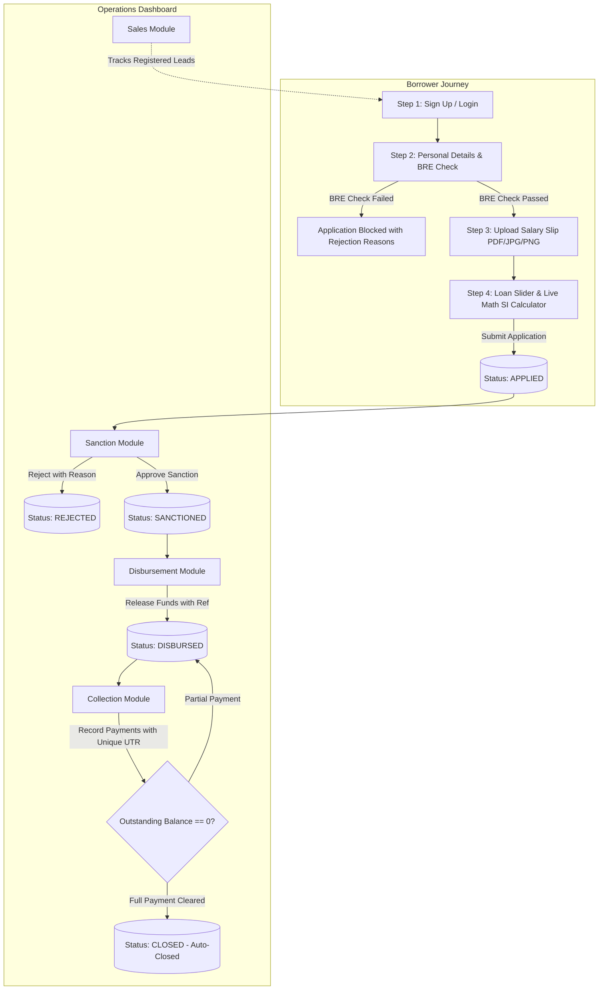

# 🏦 LoanOS — Full-Lifecycle Loan Management & Underwriting System

An enterprise-grade, full-lifecycle digital lending platform built with **Next.js (App Router)**, **Node.js/Express with TypeScript**, and **MongoDB with Mongoose**.

The platform is partitioned into two core experiences:
1. **Borrower Application Portal**: A 4-step loan application journey featuring an automated server-side **Business Rule Engine (BRE)** and interactive Simple Interest calculators.
2. **Operations Dashboard**: A role-segregated executive command center spanning **Sales**, **Sanction**, **Disbursement**, and **Collection** modules guarded by strict Role-Based Access Control (RBAC).

---

## 🚀 Credentials

All accounts are pre-seeded in the database with sample loans populated across each lifecycle stage. You can also use the **1-Click Role Switcher** button located in the top navigation bar of the web app.

| Role | Name | Email | Password | Primary Module & Capabilities |
| :--- | :--- | :--- | :--- | :--- |
| **Admin** | Aditya Birla | `admin@lms.com` | `Password@123` | **Super-user**: Full access to all 4 operations modules, financial stats, and audit logs. |
| **Sales** | Sanjay Kapoor | `sales@lms.com` | `Password@123` | **Stage 1 (Pre-Application)**: Lead tracking, stage monitoring, salesperson notes, and status updates. |
| **Sanction** | Ananya Verma | `sanction@lms.com` | `Password@123` | **Stage 2 (Underwriting)**: Reviews APPLIED loans, inspects BRE results & salary slips, and approves/rejects with reasons. |
| **Disbursement** | Vikram Malhotra | `disbursement@lms.com` | `Password@123` | **Stage 3 (Treasury)**: Reviews SANCTIONED loans, releases funds with transaction reference, and transitions to DISBURSED. |
| **Collection** | Pooja Hegde | `collection@lms.com` | `Password@123` | **Stage 4 (Recovery)**: Records repayments with unique UTR numbers, validates balances, and triggers loan AUTO-CLOSE. |
| **Borrower** | Rahul Sharma | `borrower@lms.com` | `Password@123` | **Borrower Portal**: Has an active disbursed loan (`LN-20261009-0003`) with repayments to demonstrate status tracking. |
| **New Lead** | Priya Patel | `priya@example.com` | `Password@123` | **Pre-application Lead**: Registered borrower currently on Step 1 to demonstrate Sales module lead pickup. |

---

## 🏛️ System Architecture & Workflow



---

## ⚙️ Tech Stack

- **Frontend**:
  - Next.js 16 (App Router) with TypeScript
  - Tailwind CSS with custom dark aesthetic & micro-animations
  - Lucide React Icons
  - Native Fetch client with JWT interceptor & auto-token renewal
- **Backend**:
  - Node.js & Express.js with TypeScript (`tsx` runtime)
  - MongoDB & Mongoose ORM
  - JWT (JSON Web Tokens) & `bcryptjs` password hashing
  - Multer multipart form-data upload middleware (type & size validation)
  - CORS, robust custom Error Handling middleware

---

## 📐 Business Rule Engine (BRE) Design

### Underwriting Rules Table
| Rule | Parameter | Rejection Condition | Business Rationale |
| :--- | :--- | :--- | :--- |
| **Age Eligibility** | Date of Birth | Age **not between 23 and 50** | Ensures applicants have established credit capacity and career stability. |
| **Minimum Income** | Monthly Salary | Salary **below ₹25,000 / month** | Guarantees sufficient monthly disposable income for debt service. |
| **PAN Verification** | PAN Card | Format does not match `^[A-Z]{5}[0-9]{4}[A-Z]{1}$` | Verifies identity against standard Indian tax permanent account number formatting. |
| **Employment Mode** | Employment | Mode is **Unemployed** | Unemployed applicants have zero primary income stream. |

### Architectural Rationale: Server-Side vs Client-Side BRE
- **Server-Side Execution (Mandatory for Integrity)**:
  - Client-side code can be inspected, manipulated, or bypassed using automated API clients (e.g. Postman, curl, browser DevTools).
  - Executing BRE on the Express backend guarantees **tamper-proof credit underwriting** and regulatory compliance.
  - Every evaluation is audited in the `AuditLog` collection.
- **Client-Side Validation (UX Optimization)**:
  - Instant form feedback saves unnecessary server round-trips for basic typing errors before submission.

---

## 🧮 Loan Mathematical Model (Simple Interest)

Loan calculations adhere to standard NBFC/fintech guidelines:
- **Principal ($P$)**: ₹50,000 to ₹5,00,000 (configurable via slider)
- **Tenure ($T$)**: 30 to 365 days (configurable via slider)
- **Annual Interest Rate ($R$)**: Fixed at **12% p.a.**

### Formulas:
$$\text{Simple Interest (SI)} = \frac{P \times R \times T}{365 \times 100}$$

$$\text{Total Repayment} = P + \text{SI}$$

$$\text{Daily Interest Rate} = \frac{P \times R}{365 \times 100}$$

### Example Calculation:
For a loan of **₹1,00,000** for **90 days** at **12% p.a.**:
$$\text{SI} = \frac{100000 \times 12 \times 90}{36500} = ₹2,958.90$$
$$\text{Total Repayment} = ₹1,00,000 + ₹2,958.90 = ₹1,02,958.90$$

---

## 🛡️ Role-Based Access Control (RBAC) Matrix

Access control is enforced on **both the Frontend and Backend**:

| Module / Endpoint | Admin | Sales | Sanction | Disbursement | Collection | Borrower |
| :--- | :---: | :---: | :---: | :---: | :---: | :---: |
| **Borrower Application Portal** (`/borrower/*`) | ✅ | ❌ | ❌ | ❌ | ❌ | ✅ |
| **Sales Leads Module** (`/dashboard/sales`) | ✅ | ✅ | ❌ | ❌ | ❌ | ❌ |
| **Sanction Review Module** (`/dashboard/sanction`) | ✅ | ❌ | ✅ | ❌ | ❌ | ❌ |
| **Disbursement Module** (`/dashboard/disbursement`) | ✅ | ❌ | ❌ | ✅ | ❌ | ❌ |
| **Collection Module** (`/dashboard/collection`) | ✅ | ❌ | ❌ | ❌ | ✅ | ❌ |
| **Record Payment API** (`POST /api/payments`) | ✅ | ❌ | ❌ | ❌ | ✅ | ❌ |

- **HTTP Status Codes for Unauthorized Access**:
  - `401 Unauthorized`: Missing, invalid, or expired JWT token.
  - `403 Forbidden`: Authenticated user role is not authorized for the requested endpoint.
  - `422 Unprocessable Entity`: Business Rule Engine validation rejection.
  - `409 Conflict`: Duplicate unique fields (e.g. Email or Payment UTR number).

---

## 📂 Project Structure

```
LMS/
├── backend/
│   ├── src/
│   │   ├── config/              # MongoDB connection & environment loader
│   │   ├── constants/           # Roles, LoanStatus, BRE thresholds, interest rates
│   │   ├── controllers/         # Auth, Borrower, Loan, Payment, Lead controllers
│   │   ├── middleware/          # Auth JWT, RBAC guards, Multer uploads, Error handling
│   │   ├── models/              # User, Loan, Payment, Lead, AuditLog Mongoose schemas
│   │   ├── routes/              # Express API route declarations
│   │   ├── services/            # BRE Rule Engine & Loan Math calculation services
│   │   ├── scripts/             # Database seeder & E2E integration test suite
│   │   ├── uploads/             # Storage for uploaded salary slips
│   │   ├── app.ts               # Express application configuration
│   │   └── server.ts            # HTTP server startup
│   ├── .env.example
│   ├── package.json
│   └── tsconfig.json
├── frontend/
│   ├── src/
│   │   ├── app/
│   │   │   ├── layout.tsx       # Root layout with AuthProvider & Navbar
│   │   │   ├── page.tsx         # Modern landing page & portal selector
│   │   │   ├── login/           # Login page with 1-click test credentials autofill
│   │   │   ├── signup/          # Borrower registration page (Step 1)
│   │   │   ├── borrower/        # Borrower Portal & status timeline
│   │   │   │   └── apply/       # Multi-step loan application wizard (Steps 1-4)
│   │   │   └── dashboard/       # Operations Dashboard
│   │   │       ├── layout.tsx   # Sidebar navigation & RBAC guard
│   │   │       ├── page.tsx     # Admin executive statistics overview
│   │   │       ├── sales/       # Sales Module (Lead pipeline & notes)
│   │   │       ├── sanction/    # Sanction Module (Underwriting review)
│   │   │       ├── disbursement/# Disbursement Module (Fund release)
│   │   │       └── collection/  # Collection Module (Payment & auto-closure)
│   │   ├── components/          # StatusBadge, LoanSlider, RoleGuard, DemoModal, etc.
│   │   ├── context/             # AuthContext (state, login, role switcher)
│   │   ├── lib/                 # Centralized typed API client
│   │   └── types/               # TypeScript interfaces and enums
│   ├── .env.example
│   ├── package.json
│   └── tsconfig.json
├── README.md
└── .env.example
```

---

## ⚡ Installation & Setup Instructions

### Prerequisites
- **Node.js** (v18.x or higher)
- **MongoDB** (running locally on port 27017 or a MongoDB Atlas URI)

### 1. Backend Setup
```bash
cd backend
npm install

# Copy environment variables
cp .env.example .env

# Seed the database with all role accounts and test loans
npm run seed

# Start backend server (starts on http://localhost:5000)
npm run dev
```

### 2. Frontend Setup
```bash
cd ../frontend
npm install

# Copy environment variables
cp .env.example .env.local

# Start Next.js development server (starts on http://localhost:3000)
npm run dev
```

Visit **`http://localhost:3000`** in your browser.

---

## 🧪 Automated End-to-End Verification

A comprehensive automated test suite is included to verify all business rules, math formulas, and role transitions:

```bash
cd backend
npx tsx src/scripts/testE2E.ts
```

# Video Walkthrough
https://drive.google.com/file/d/167xfUJBKTaK2gJ3tPTfa2XqFfu96V7ni/view?usp=sharing

